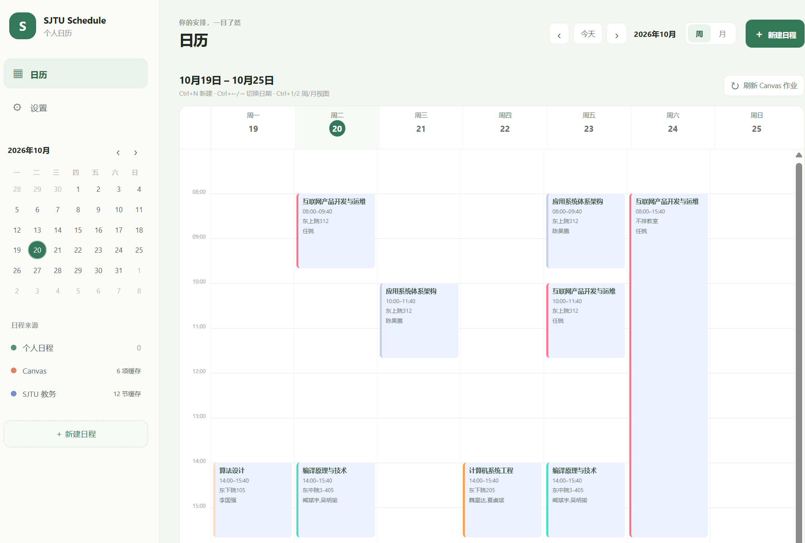
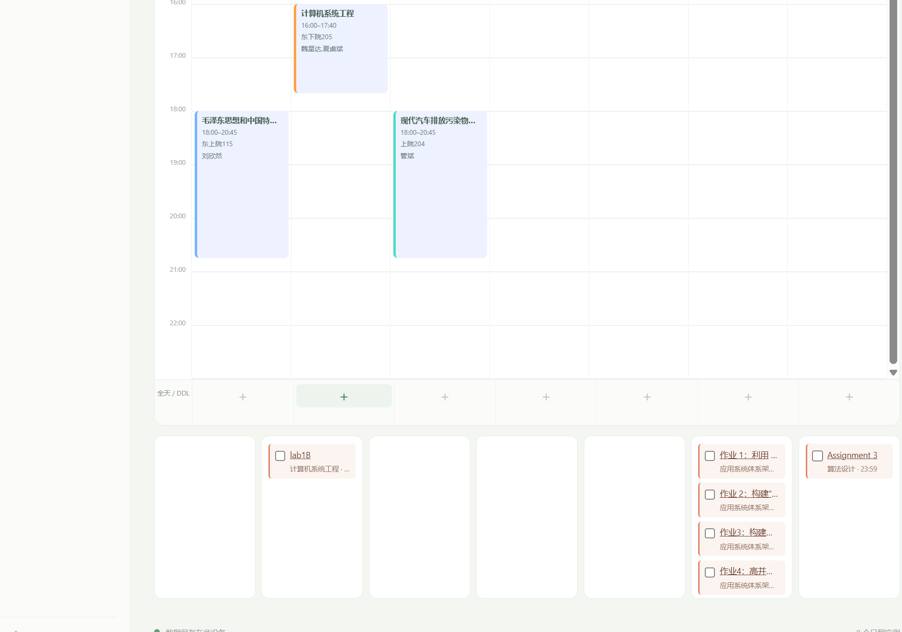

# SJTU Schedule

本地优先的 Windows 日历应用，使用 Tauri 2、React、TypeScript、Rust 和 SQLite。当前包含个人日程及重复事件、周/月日历、Canvas 作业缓存、SJTU 课程缓存，以及明确标记为本地个人日程的 ICS 课表导入。Windows 桌面 Widget 在独立的 `feat/desktop-widget` 分支开发，主窗口稳定版本暂未包含。

## 应用预览





## 下载 Windows 版本

从 [GitHub Releases](https://github.com/S1mpleWind/sjtu-calendar/releases/latest) 下载最新的 x64 Windows 安装包。

## Windows 开发环境

- Windows 10/11 x64、Node.js 22、pnpm 10
- Rust stable `x86_64-pc-windows-msvc`
- Visual Studio 2022 Build Tools（Desktop development with C++）和 Windows SDK
- Microsoft Edge WebView2 Runtime

已使用 Windows 10 Pro build 26200、Node `v22.20.0`、pnpm `10.12.1`、Rust `1.98.1`、Visual Studio Build Tools `17.14.37628.2`、Windows SDK `10.0.26100.0`、WebView2 Runtime `155.0.4283.62` 开发。

## 安装与启动

```powershell
corepack enable
pnpm install --frozen-lockfile
pnpm tauri dev
```

桌面数据保存在 Tauri `app_data_dir` 的 SQLite 数据库中，并由 Rust 迁移升级。日程、已缓存 Canvas 作业及已缓存课表都可以离线读取。

桌面 Widget 提供紧凑的半透明窗口：启动后 Widget 显示、主窗口留在系统托盘中，可从 Widget 唤醒主程序。两者读取同一份本地缓存；关闭窗口会将应用保留在托盘。此功能包含在 v1.0.0 Windows 版本中。

点击左侧「DDL 总览」可按月查看每天的截止事项：红色表示当天有未完成项目，黄色表示当天全部完成，灰色表示没有 DDL。点击日期展开当天清单并勾选完成，可用顶部箭头切换月份。

总览自动统计 Canvas 作业（本地勾选完成或 Canvas 已提交/已评分均算完成）。自定义日程可在编辑器勾选「纳入 DDL 总览」，按开始日期归类；重复日程每次独立完成。已有的本地「截止事项」会在数据库升级时自动纳入，也可取消勾选。

## 检查与 Windows 打包

```powershell
pnpm lint
pnpm test
pnpm build
Push-Location src-tauri
cargo fmt --check
cargo test
Pop-Location
pnpm tauri build
```

Windows 安装包由 `src-tauri/tauri.conf.json` 的 Tauri bundle targets 配置生成。实际产物路径和本机打包结果记录在 `docs/development-log.md`。

## 连接数据源

- **Canvas**：在“设置 → Canvas 同步”选择交大 Canvas 实例并输入个人访问令牌；应用先安全保存，再用“测试连接”验证。Token 仅保存在 Windows Credential Manager。
- **SJTU 教务**：选择本科或研究生后打开独立交大登录窗口，由用户本人完成 SSO/MFA。回到主窗口保存会话，填写学年、学期、首周周一与教学周数，再刷新课表。Cookie 保存在 Windows Credential Manager。状态说明和手工验证步骤见 [`docs/integration-sjtu.md`](docs/integration-sjtu.md)；当前接口仍是源码审计状态，尚无真实账户验证。
- **ICS 课表导入**：在同页选择 ICS 文件，填写学期首周周一和教学周数，先预览再应用。导入记录作为本地个人日程，不会伪装为教务同步。

不要把密码、SSO Cookie 或 Canvas Token 发到聊天、提交到 Git 或存入 SQLite。账户验证失败时，应用保留旧缓存并显示错误。

## 数据备份

设置中的“数据备份与恢复”可导出本地 SQLite 数据库备份文件，并从备份恢复日程和同步缓存。备份包含个人数据及远端缓存，不含保存在 Windows Credential Manager 的 Token/Cookie；恢复后需要重新验证外部账户连接。请将备份文件保存在受信任的位置。

## 项目资料

- [`docs/architecture.md`](docs/architecture.md)：模块和数据流
- [`docs/data-model.md`](docs/data-model.md)：SQLite schema 与迁移
- [`docs/known-limitations.md`](docs/known-limitations.md)：尚未验证的行为
- [`docs/operations.md`](docs/operations.md)：登录、ICS、备份与恢复指南
- [`docs/acceptance-tests.md`](docs/acceptance-tests.md)：阶段验收清单
- [`docs/development-log.md`](docs/development-log.md)：工具链、测试和 Git SHA
- [`THIRD-PARTY-NOTICES.md`](THIRD-PARTY-NOTICES.md)：直接依赖许可证清单

`references/` 中的两个克隆仓库只读并由 Git ignore。SJTU-Course-Block 未找到许可证文件，本项目只审计其行为，没有复制其实现。
